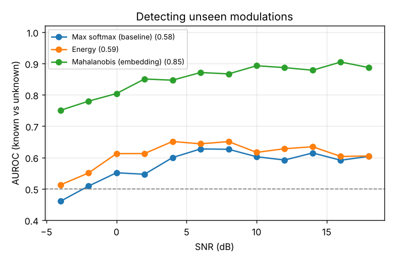
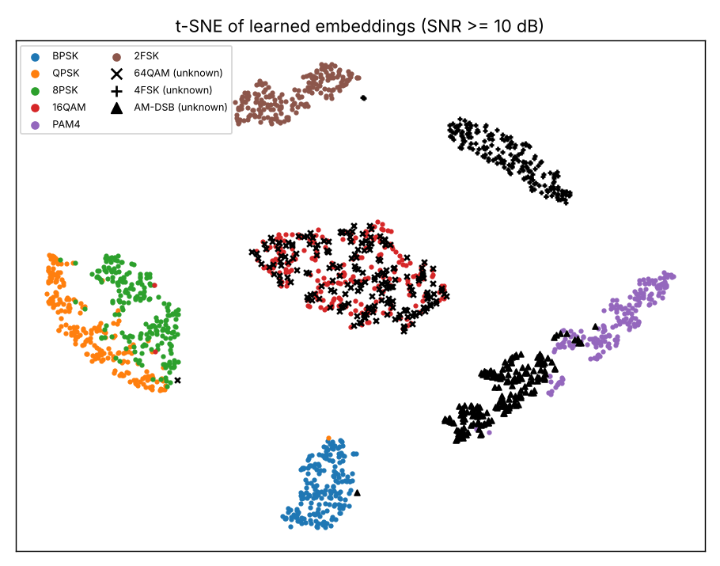

# Open-Set Modulation Recognition

Recognize known wireless signal types **and flag ones the model has never seen**, then add new types from a handful of labelled examples without retraining.

## Setup

| | |
|---|---|
| Known classes (trained on) | BPSK, QPSK, 8PSK, 16QAM, PAM4, 2FSK |
| Unknown classes (never seen in training) | 64QAM, 4FSK, AM-DSB |
| Input | 128 complex baseband (I/Q) samples, root-raised-cosine pulse shaping |
| Impairments | random phase offset, carrier frequency offset, AWGN at −4 to 18 dB SNR |
| Model | 4-layer 1D CNN → 64-d embedding → classifier (~60k parameters, trains on CPU) |

Data is generated by `signals.py`, so the experiment runs offline with no dataset download.

## Results

**Closed-set accuracy on known classes: 86.7%** overall, about 97% at 10 dB and above. The remaining errors are QPSK vs 8PSK, which are physically close.

**Detecting unseen classes** (AUROC, where 0.5 = random and 1.0 = perfect):

| Method | AUROC | 64QAM | 4FSK | AM-DSB | Unknowns rejected* |
|---|---|---|---|---|---|
| Max softmax (baseline) | 0.58 | 0.45 | 0.67 | 0.62 | 5% |
| Energy score | 0.59 | 0.48 | 0.61 | 0.69 | 6% |
| **Mahalanobis distance in embedding** | **0.85** | 0.60 | **0.99** | **0.96** | **60%** |

\*Threshold set on validation data so 95% of known signals are accepted.

**Few-shot incremental learning:** each new class is added as the mean of just 10 labelled embeddings, with no weight updates. New classes reach 63.5% accuracy, while old-class accuracy drops from 84.9% to 74.4%.




## What I learned

1. **Softmax confidence is unreliable for detecting novelty.** The classifier is confidently wrong on unknown signals. Distance in the learned feature space works much better, because unknowns land away from every known cluster.
2. **Some unknowns are hard for a structural reason.** 64QAM overlaps almost completely with 16QAM in the embedding (see t-SNE). Training only to separate the 6 known classes never forced the model to encode the finer amplitude levels that distinguish them. 4FSK and AM-DSB, which are structurally different, are detected almost perfectly.
3. **Incremental learning has a cost.** Adding a 64QAM prototype pulls some 16QAM signals away from their own class, which explains most of the old-class accuracy drop.

## Next steps

- Train the embedding with **contrastive / supervised-contrastive loss**, so features capture more than the 6-way decision boundary. This is the most likely fix for the 64QAM case.
- Evaluate on the **RadioML 2018.01A** benchmark with real over-the-air impairments.
- Replace prototype-only updates with a **continual learning** method (e.g. replay or distillation) to reduce the old-class accuracy drop.

## Run

```bash
pip install -r ../requirements.txt
python run.py      # ~5 min on a laptop CPU; writes results/
```
