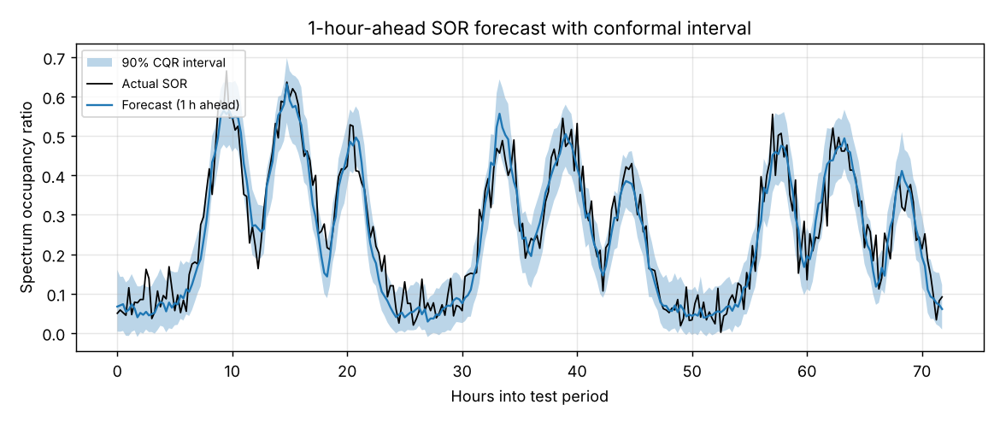
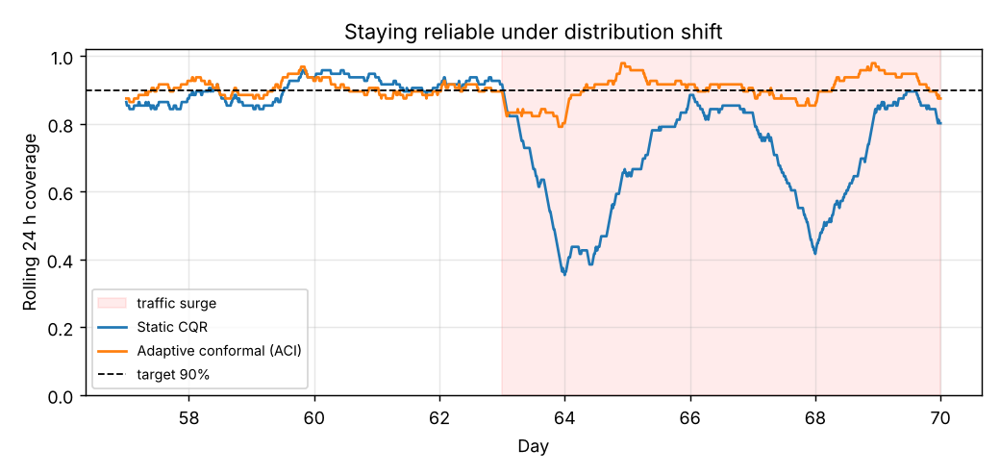

# Trustworthy Spectrum Occupancy Forecasting

Forecast the **Spectrum Occupancy Ratio (SOR)** one hour ahead and attach a **90% prediction interval with a distribution-free coverage guarantee**. The interval stays reliable when traffic suddenly changes.

## Setup

| | |
|---|---|
| Data | 70 days of simulated sensing on a 20-channel band (`spectrum.py`), with daily and weekly traffic patterns and bursty on/off channel activity, aggregated into 15-minute SOR values |
| Split | train days 0–41, calibration days 42–55, test days 56–69 |
| Forecaster | MLP on the last 24 h of SOR plus time-of-day, trained with pinball loss to output the 5%, 50% and 95% quantiles |
| Uncertainty | split conformal prediction, conformalized quantile regression (CQR), adaptive conformal inference (ACI) |

## Results

**Point forecast (1 h ahead), test MAE:**

| Method | MAE |
|---|---|
| Persistence (last value) | 0.094 |
| Seasonal naive (same time yesterday) | 0.103 |
| **MLP (median)** | **0.038** |

**90% intervals on test data:**

| Method | Coverage | Mean width |
|---|---|---|
| Raw quantile regression | 77.5% ❌ | 0.112 |
| Split conformal | 88.9% | 0.155 |
| **CQR** | **88.2%** | **0.146** |

**Traffic surge** (load ×1.6 from day 63 onward, a distribution shift the model never saw):

| Method | Coverage before | Coverage during surge |
|---|---|---|
| Static CQR | 90.0% | 68.5% ❌ |
| **CQR + ACI (rolling calibration)** | **90.2%** | **89.9%** |




## What I learned

1. **A model's own uncertainty estimates can't be trusted out of the box.** The quantile-regression model claimed 90% intervals but covered only 77.5%. Conformal calibration on held-out data restores near-target coverage using no assumptions about the data distribution.
2. **CQR gives sharper intervals than plain split conformal.** Its width adapts to the time of day, narrow at quiet night hours and wide at busy peaks, so it reaches similar coverage with tighter intervals.
3. **Static guarantees break under distribution shift.** During the surge, fixed intervals dropped to 68.5% coverage. ACI widens the intervals after misses and tightens them after hits, which held coverage at about 90% throughout.
4. **Coverage lands slightly under 90% (about 88–89%) without shift.** Conformal guarantees assume exchangeable data, and time series are autocorrelated. This is a known open issue for spectrum data.

## Next steps

- Replace the MLP with a sequence model (LSTM or transformer) and forecast multiple horizons.
- Use **real spectrum measurements** (e.g. public RF sensing datasets) instead of simulation.
- Turn intervals into **risk-aware access decisions**: transmit only when the upper bound on occupancy is below a threshold, and measure the trade-off between throughput and collisions.

## Run

```bash
pip install -r ../requirements.txt
python run.py      # ~3 min on a laptop CPU; writes results/
```
